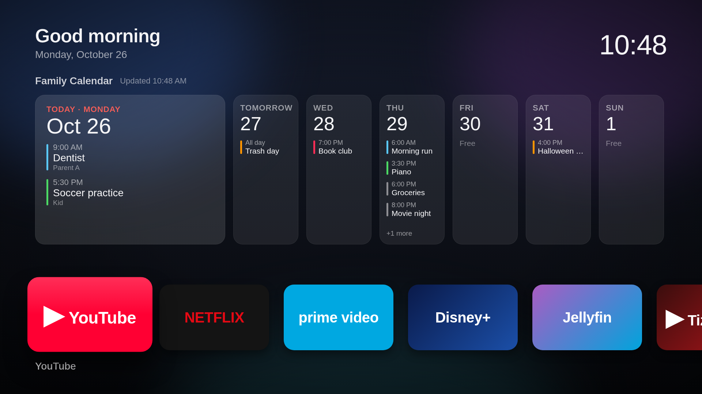

# TV Home

An Apple TV-style home screen for Samsung Tizen TVs, packaged as a
[TizenBrew](https://github.com/reisxd/TizenBrew) application module.

 *(sample data)*

- Clock and date header, dark wallpaper, large rounded app tiles that lift on focus.
- Fully D-pad driven: arrows move, Enter opens, Back closes overlays.
- Launches installed TV apps (YouTube, Netflix, Prime Video, Disney+, Jellyfin, Apple TV,
  Spotify when installed) and your other TizenBrew modules (TizenTube etc.).
- Optional family-calendar "top shelf" fed by a small server on your own network.

## Add it in TizenBrew

TizenBrew → Module Manager → **Add GitHub Module** → type `OWNER/tv-home`
(the GitHub owner and repo name), then open **TV Home** from the module list.
To open it every time TizenBrew starts, set it under TizenBrew Settings → Autolaunch.

## How app launching works

TizenBrew pages do not get Tizen APIs, so the module ships a small helper service
(`service/service.js`) that TizenBrew runs with access to `tizen.application`.
It listens on `127.0.0.1:8097` only:

- `GET /apps` installed apps
- `GET /launch?id=<tizenAppId>` launch an app
- `GET /module?name=<module>&type=<npm|gh>` open another TizenBrew module

If the service is unreachable the page falls back to the TV's local REST API
(`POST http://127.0.0.1:8001/api/v2/applications/<id>`).

## Calendar feed (optional, stays on your LAN)

No calendar data or credentials live in this repo. The page reads a JSON feed from a
URL you set (default in `app/config.js`, changeable on the TV under the **Settings** tile):

```json
{ "ok": true, "events": [ { "title": "...", "start": "ISO-8601", "end": "ISO-8601",
  "allDay": false, "people": [ { "name": "...", "color": "#hex" } ] } ] }
```

`feed/` contains a reference server for Skylight calendars built on the
[`skylight-mcp`](https://www.npmjs.com/package/skylight-mcp) client. On a Mac:

```sh
cp -r feed ~/tv-home-feed && cd ~/tv-home-feed
printf 'SKYLIGHT_EMAIL=you@example.com\nSKYLIGHT_PASSWORD=...\n' > skylight.env
./install-mac.sh      # installs a launchd agent serving http://<mac-ip>:8787/calendar.json
```

Anyone on your home network can read that feed, so only run it on a trusted LAN.
If the feed is unreachable the shelf shows "Calendar offline" (or the last saved schedule)
and the app tiles keep working.

## Notes

- Written in ES5 / old-Chromium-safe CSS for 2018-2020 Tizen TVs.
- TizenBrew modules cannot replace Samsung's own home screen or start at TV power-on;
  Autolaunch opens this as soon as TizenBrew is opened.
